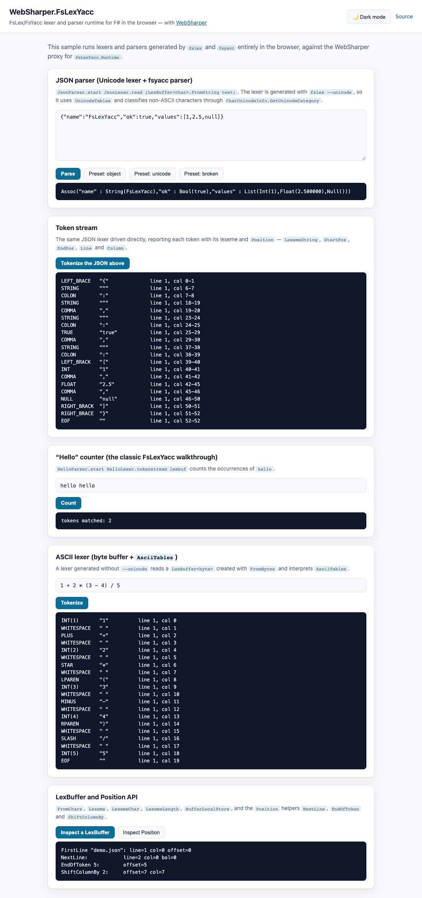

WebSharper.FsLexYacc
====================

[](https://www.nuget.org/packages/WebSharper.FsLexYacc)

WebSharper proxy for [FsLexYacc](https://fsprojects.github.io/FsLexYacc): run
`fslex`/`fsyacc`-generated lexers and parsers entirely in the browser, in F#.

This repository is a fork of [fsprojects/FsLexYacc](https://github.com/fsprojects/FsLexYacc)
that adds the `WebSharper.FsLexYacc` proxy package and a sample.

Repository layout
-----------------

| Project | Description |
|---|---|
| `src/FsLexYacc.Runtime` | The FsLexYacc runtime (`FSharp.Text.Lexing`, `FSharp.Text.Parsing`) |
| `src/FsLex`, `src/FsYacc`, `src/*.Core` | The `fslex`/`fsyacc` tools |
| `websharper/WebSharper.FsLexYacc.Runtime` | The WebSharper proxy that compiles the runtime to JavaScript |
| `Sample/WebSharper.FsLexYacc.Sample` | The sample, doubling as the binding's test case |

Live demos
----------

**Try it live:** [Open the sample in your browser](https://dotnet-websharper.github.io/FsLexYacc.Runtime/)



The sample doubles as the binding's [test case](#running-the-test-case): it parses
JSON with a `fslex --unicode` lexer and a `fsyacc` parser, streams the tokens with
their positions, counts `hello` (the classic FsLexYacc walkthrough), tokenizes an
ASCII byte buffer through `AsciiTables`, and exercises the `LexBuffer`/`Position`
API.

- Source: <https://github.com/dotnet-websharper/FsLexYacc.Runtime>
- Sample gallery: <https://websharper.com/samples>
- WebSharper: <https://websharper.com>

Install
-------

```
dotnet add package WebSharper.FsLexYacc
```

or

```
nuget install WebSharper.FsLexYacc
```

Usage
-----

Generate your lexer and parser with `fslex`/`fsyacc` as usual, then drive them
from F#:

```fsharp
open FSharp.Text.Lexing

let parse (text: string) =
    // FromString gives a char LexBuffer; seed the position with the first line
    // so that reported line numbers are 1-based.
    let lexbuf = LexBuffer<char>.FromString text
    lexbuf.EndPos <- Position.FirstLine "(input)"
    Parser.start Lexer.tokenstream lexbuf
```

To run it in the browser, reference this package and mark the client code (and
the generated lexer/parser modules) for WebSharper. The sample shows the
attribute placement:

```fsharp
[<WebSharper.JavaScript>]
module Lexer   // generated by fslex

[<WebSharper.JavaScript>]
module Parser  // generated by fsyacc
```

### What the proxy covers

- The `FSharp.Text.Lexing` / `FSharp.Text.Parsing` surface used by generated
  lexers and parsers: `LexBuffer<'char>` (the string/char/byte factories,
  `Lexeme`, `LexemeChar`, `LexemeLength`, `LexemeString`, `StartPos`, `EndPos`,
  `BufferLocalStore`, `IsPastEndOfStream`, `DiscardInput`), `Position`,
  `AsciiTables` and `UnicodeTables` `Interpret`, `Tables<'tok>`, `IParseState`,
  `ParseErrorContext` and `ParseSettings`.
- **Unicode categories.** `fslex --unicode` lexers classify non-ASCII input with
  `System.Globalization.CharUnicodeInfo.GetUnicodeCategory`; the proxy implements
  it with the JavaScript Unicode property escapes (`\p{...}`), so Greek,
  Cyrillic, emoji, and so on are handled correctly.
- **Browser-only.** The reader/stream based factories — `FromTextReader`,
  `FromBinaryReader`, `FromStream` and `UnicodeFileAsLexbuf` — are .NET-only,
  because browsers have no synchronous file IO. Read the file content first with
  the File or Fetch APIs and use `FromString`/`FromChars`/`FromBytes` instead.

Running the test case
---------------------

```
dotnet tool restore
dotnet paket restore
dotnet build Sample/WebSharper.FsLexYacc.Sample/WebSharper.FsLexYacc.Sample.fsproj -c Release
dotnet serve -d Sample/dist -p 8080
```

Then open <http://localhost:8080>. (Install
[dotnet-serve](https://github.com/dotnet-serve/dotnet-serve) once with
`dotnet tool install -g dotnet-serve`.)

The sample commits the `fslex`/`fsyacc` output so that it builds without the
tools. Regenerate it after editing a `.fsl`/`.fsy`:

```
cd Sample/WebSharper.FsLexYacc.Sample
./regenerate.sh
```

Build from source
-----------------

The repository builds through Paket and the shared
[`dotnet-websharper/build-script`](https://github.com/dotnet-websharper/build-script)
tooling:

```
./build WS-BuildRelease   # build the proxy in Release
./build WS-Package        # build and pack the NuGet package
```

On Windows use `build.cmd` instead of `build.sh`.

Deployment
----------

`.github/workflows/ghpages.yml` builds the sample in Release on every push to
`master` and deploys `Sample/dist` to GitHub Pages. `ci.yml` builds the proxy and
the sample on pushes and pull requests.

License
-------

The WebSharper proxy and the FsLexYacc runtime/tools in this repository are
[MIT](LICENSE.md) licensed. The upstream project is
[fsprojects/FsLexYacc](https://github.com/fsprojects/FsLexYacc) (also MIT,
Copyright (c) Microsoft Corporation).
